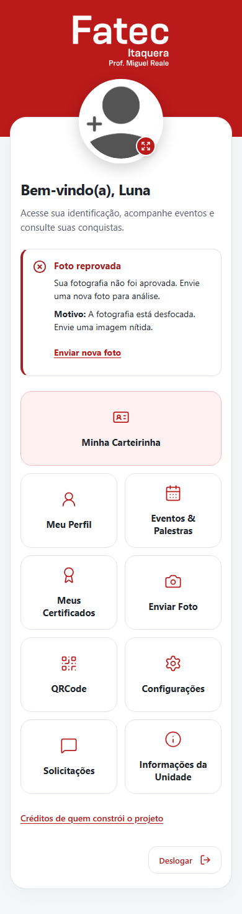
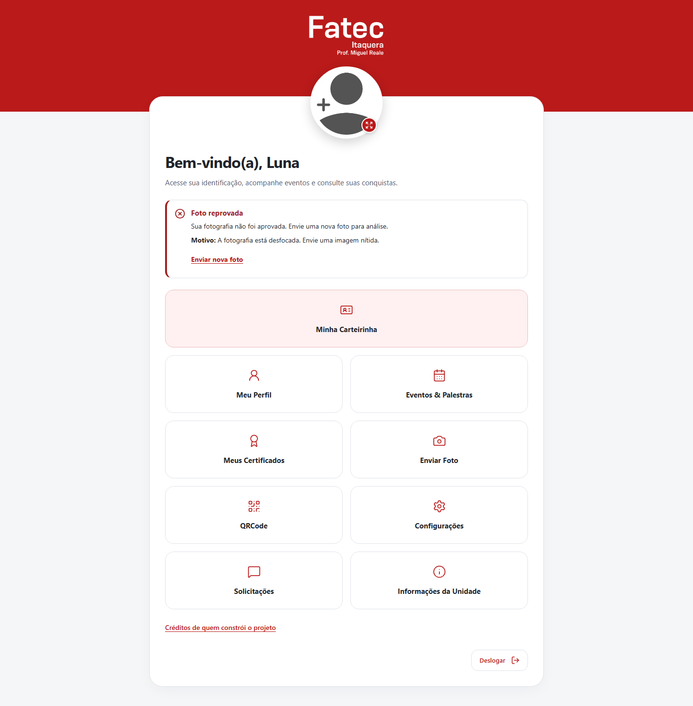
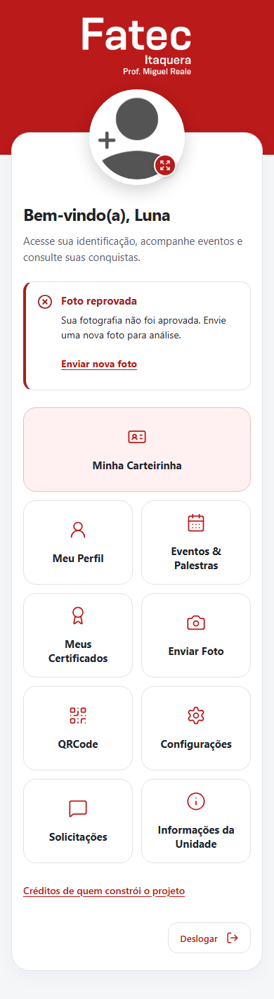
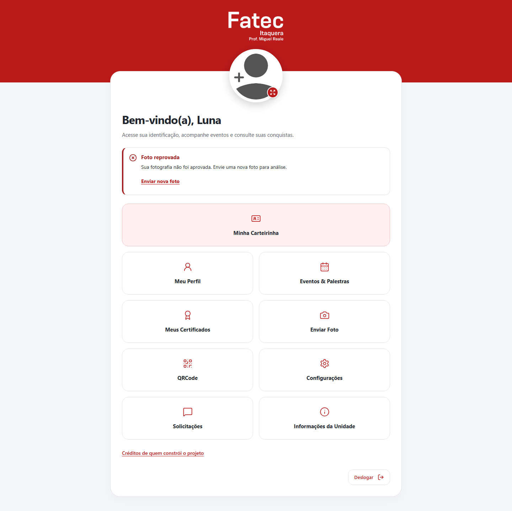
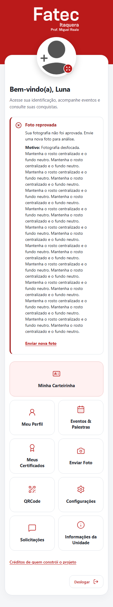
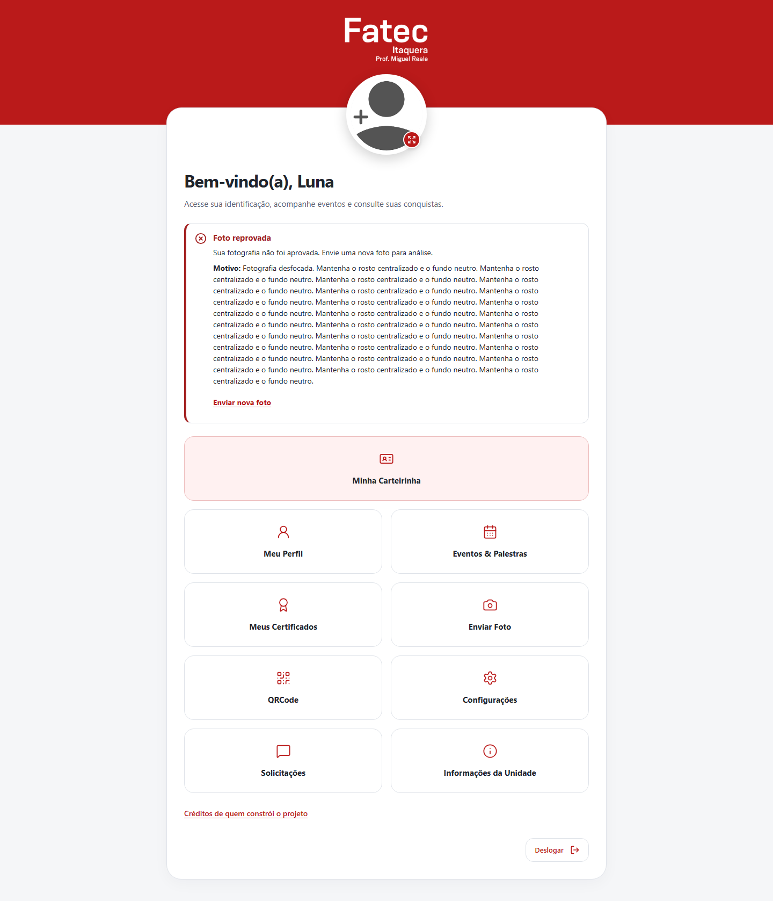
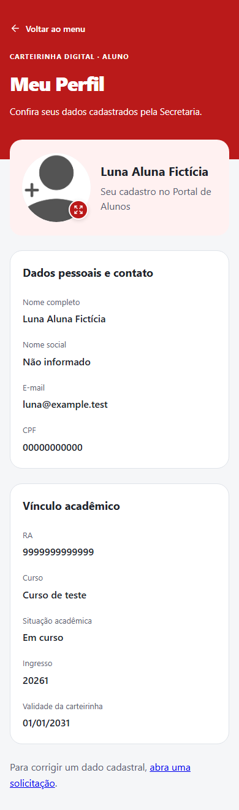
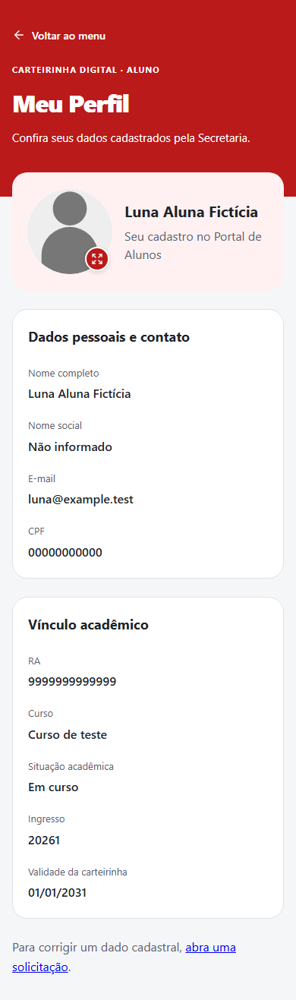
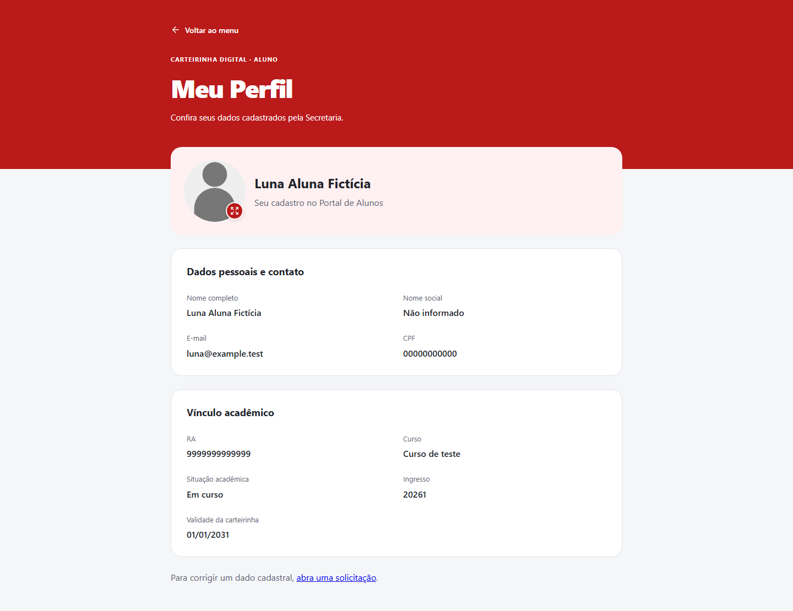
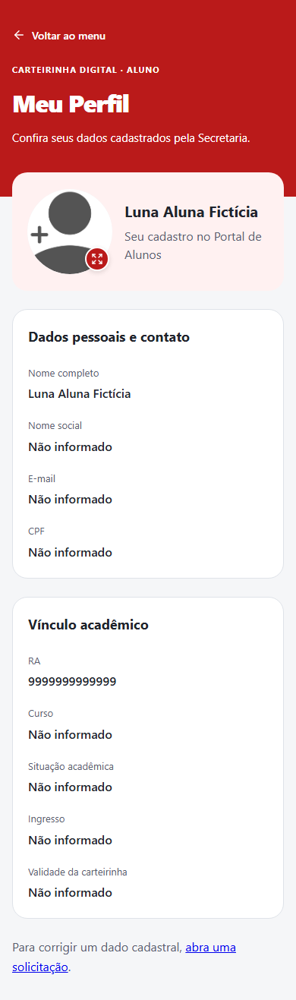

# Meu Perfil e motivo da fotografia reprovada — issue #53

## Escopo e referências

Base do Portal de Alunos: main 880745a1401615592dd9561d671fb5783b3db011. Referência de Funcionários: main 3bba6e253af9d048550ce6f1f4f1309456fbd371. Foi conferida a lista de PRs abertos de Funcionários: somente o Draft #2, de auditoria/documentação, sem implementação posterior de Meu Perfil. A experiência de consulta atual da main foi usada como referência, sem copiar carteirinha/flip ou outras alterações.

Branch: feature/issue-53-meu-perfil-motivo-foto. Entrega em Draft, sem merge, deploy de produção, migração ou dados reais.

## Card e perfil

Um único card Meu Perfil, com UserRound, usa os mesmos estilos e dimensões dos cards existentes da Home. O novo card equilibra a grade; Informações da Unidade ocupa sua posição no par final, sem linha isolada. O restante da navegação e dos cards foi preservado.

A rota /meu-perfil está dentro de StudentRoute. Reutiliza PageLayout, StudentPhoto (inclusive ampliação e fluxo existente de alterar foto) e a organização de seções/grid do EmployeeProfile, com as cores institucionais do aluno. Não há formulário ou endpoint novo de edição.

Campos mostrados: nome, nome social, e-mail, CPF, RA, curso, situação acadêmica, ingresso e validade da carteirinha. Ausências aparecem como Não informado. A fotografia é a já aprovada do perfil; demais estados usam o placeholder existente.

O backend já substitui name pelo nome social para o próprio aluno. Quando há socialName, a tela rotula name como Nome de identificação, sem inventar o nome civil não recebido. Unidade individual, período e semestre atual não existem no contrato e não foram fabricados. RG não vem no DTO. birthDate não foi exposto na tela porque o mapper legado usa a data atual como fallback quando ausente, sem indicador que permita distinguir o dado real. Nenhum token de QR Code é exibido no perfil.

## Consulta, sessão e atualização

Home e perfil compartilham um recurso em memória vinculado ao token atual. A consulta do próprio perfil usa o RA do token no endpoint já existente, cache HTTP no-store e AbortSignal; uma resposta cujo token tenha mudado é rejeitada. O recurso também exige RA correspondente e descarta respostas de geração anterior. Os dados recentes/in-flight são reutilizados ao abrir Meu Perfil. Ao voltar à Home, a situação é revalidada para preservar o comportamento de atualização existente, mantendo nome/foto e aviso confirmado durante a consulta. Foco, reconexão, visibilidade e atualização periódica também revalidam.

O cache persistido legado não é usado para preencher a nova consulta sem prova de vínculo com a sessão. A fotografia da Home provém somente do perfil da sessão, sem reaproveitar uma imagem offline global de proprietário desconhecido. A lógica da carteirinha e do QR não foi alterada. Uma falha de atualização preserva os últimos dados da sessão no perfil e indica indisponibilidade; a Home não apresenta motivo de cache como decisão atual após falha. Expiração ou HTTP 401 remove a sessão/dados; troca de token limpa imediatamente o estado e invalida respostas atrasadas.

Após sucesso real do serviço de upload existente, o recurso é invalidado. A identidade permanece, mas a aprovação/reprovação anterior não é tratada como atual antes da nova consulta. Nenhuma regra de aprovação ou escrita da Secretaria foi alterada.

## Mensagem preservada exatamente

Título: **Foto reprovada**.

Mensagem: **Sua fotografia não foi aprovada. Envie uma nova foto para análise.**

Ambos permanecem literalmente iguais. A única adição ao aviso é **Motivo:** seguido do texto retornado pelo backend quando photoStatus é REJECTED e a justificativa é uma string não vazia. Mantêm-se cor, borda, ícone, link Enviar nova foto e comportamento de fechamento existentes. O X continua somente no aviso aprovado; nenhum botão de fechamento foi inventado para a rejeição. O motivo é texto React escapado, com quebra de linha e palavras longas, sem interpretação de HTML. Pendentes/aprovadas ou motivo nulo/ausente/vazio não mostram Motivo.

## Causa e dependência de backend

A Secretaria já envia rejectionReason e StudentService.approvePhoto o grava. A resposta autenticada usada pelo Portal passava por StudentMapper/ViewStudentDTO, que omitiam a justificativa. A rota legado foto-status retorna o motivo, porém é pública e não foi escolhida para esta integração.

Foi criada a [issue #106](https://github.com/Carteirinha-Digital-Fatec-Itaquera/carteirinha-digital-backend/issues/106) e o [PR Draft #107](https://github.com/Carteirinha-Digital-Fatec-Itaquera/carteirinha-digital-backend/pull/107), com a adição mínima de rejectionReason na resposta do próprio aluno, após as verificações existentes de RA/accountId. Nos demais estados retorna null, inclusive motivo antigo retido no banco após um novo envio. Não há alteração de esquema, aprovação, QR, mapper compartilhado ou projeção pública.

O frontend é compatível com o backend atual: sem o novo campo continua mostrando exatamente a mensagem existente. O motivo só ficará disponível pela consulta autenticada depois da revisão e integração separada do backend. Não houve merge/deploy de nenhum dos dois PRs. O modelo de fotografia do aluno permanece o existente; o fluxo de substituições de funcionários não foi transplantado.

## Testes e limites

- TypeScript e build Vite/PWA aprovados.
- 87 testes unitários/componentes passaram, incluindo 20 novos casos de mensagem, motivo e recurso de perfil; regressão direta de fotografia + testes novos: 28/28.
- ESLint dos arquivos TypeScript alterados: zero erros e avisos.
- Playwright com API e serviços auxiliares interceptados em 320, 390, 768 e 1440 px: card/perfil, campos reais/ausentes, navegação e reaproveitamento da consulta, fotografia aprovada, motivo presente/ausente/longo, atualização sem piscar, nova tentativa de upload fictício, troca de aluno/resposta atrasada, 401 e rota protegida.
- No backend: 28 testes pertinentes em 4 suítes; TypeScript, geração de Prisma Client e build Nest aprovados. Lint herdado e limites documentados no PR separado.

As fixtures e fotografias são fictícias/institucionais. Escritas de upload são interceptadas; nenhum arquivo ou mensagem de teste foi enviado a serviços reais. Estes testes não homologam uma API real ou produção. A validação visual e funcional desta entrega permanece pendente do usuário.

## Executar no VS Code

Clone o repositório do Portal de Alunos, abra esta branch e execute npm ci. Configure VITE_API_URL para sua API local isolada e VITE_USE_MOCK=false antes de npm run dev. Não utilize produção para operações de teste.

Para os cenários isolados: configure VITE_API_URL=http://localhost:3098 e VITE_USE_MOCK=false, execute npm run build e depois npm run test:profile-feedback:browser. O Playwright inicia preview em 127.0.0.1:5195 e intercepta a API, inclusive /api auxiliar; não é necessário backend real. Instale o Chromium com npx playwright install chromium. PLAYWRIGHT_BROWSERS_PATH e PROFILE_EVIDENCE_DIR podem definir o navegador e destino das capturas.

Execute npm run test:profile-feedback e npm run test:photo. Para todos os testes Node, use no PowerShell: $caseFiles=Get-ChildItem tests -Filter *.test.mjs | ForEach-Object FullName; node --import ./tests/register.mjs --test $caseFiles. Lint restrito: npx eslint src/api/student/studentSession.ts src/api/student/profileResource.ts src/api/student/findProfile.ts src/hooks/useStudentProfile.ts src/domains/Student.ts src/routes/index.tsx src/ui/components/photoStatus/PhotoStatus.tsx src/ui/screens/mainmenu/MainMenuScreen.tsx src/ui/screens/profile/StudentProfileScreen.tsx src/ui/screens/uploadimage/UploadImageScreen.tsx.

Para revisão manual, confirme o texto original do aviso, justificação atual quando existente, ausência de motivo em outros estados, perfil completo/incompleto, retorno e dimensões mobile/desktop. Não feche as issues nem retire o Draft antes da aprovação do responsável.

## Inspeção visual e arquivos alterados

As capturas identificaram e corrigiram um avatar sem contêiner dimensional no perfil. A versão final limita a prévia a 112 × 112 px, mantém proporção circular e reserva a ampliação para o modal existente; o Playwright verifica essas dimensões. O launcher da regressão antiga passou a usar o Chromium empacotado por padrão, preservando BROWSER_CHANNEL opcional, pois o Edge local não iniciou neste ambiente. O teste de retorno à Home foi adaptado ao novo requisito: o aviso já confirmado na sessão permanece durante a revalidação, em vez de desaparecer. As verificações de ocultar cache persistido não confirmado na primeira consulta e de não mostrar status antigo após erro foram preservadas; foram acrescentadas asserções de manter o estado pendente confirmado, sem exibir a aprovação do cache.

- package.json
- src/api/student/findProfile.ts
- src/api/student/profileResource.ts
- src/api/student/studentSession.ts
- src/domains/Student.ts
- src/hooks/useStudentProfile.ts
- src/routes/index.tsx
- src/ui/components/photoStatus/PhotoStatus.tsx
- src/ui/components/photoStatus/style.module.css
- src/ui/screens/mainmenu/MainMenuScreen.tsx
- src/ui/screens/profile/StudentProfileScreen.tsx
- src/ui/screens/profile/style.module.css
- src/ui/screens/uploadimage/UploadImageScreen.tsx
- tests/photo-ux.browser.mjs
- tests/profile-feedback.browser.mjs
- tests/profile-feedback.test.mjs

## Evidências mobile e desktop

Capturas integralmente fictícias/institucionais, geradas com API interceptada. A validação visual do usuário continua pendente.

### home-reprovada-com-motivo

### home-reprovada-sem-motivo

### home-motivo-longo

### meu-perfil

### perfil-foto-aprovada

### perfil-campos-ausentes

## Regressão adicional concluída

O script test:photo:browser passou nos nove grupos: consulta/cache/revalidação, fechamento e isolamento, armazenamento bloqueado, foto/teclado/foco/Escape/proporção, estados conhecidos/ausentes, falha de imagem, falha/offline/reconexão, envio e nova consulta, animação/movimento reduzido/envio único e falhas HTTP/rede. Inclui 320/390/1440 px e paisagem 844 × 390. O launcher usa Chromium por padrão; BROWSER_CHANNEL permite escolher outro canal instalado. A tentativa inicial com Edge não iniciou neste ambiente; o run final usou Chromium e passou. O encerramento da sessão offline legado encontrou um serviço local indisponível (localhost:3000), tratado pelo fluxo existente; nenhuma escrita em produção foi efetuada.

Todos os cenários novos de perfil/motivo, inclusive a asserção de avatar 112 × 112, passaram em 320/390/768/1440 px. Não há conflito de contrato com o backend atual: a ausência de rejectionReason é tolerada. A disponibilização real do motivo aguarda o PR separado de backend.
